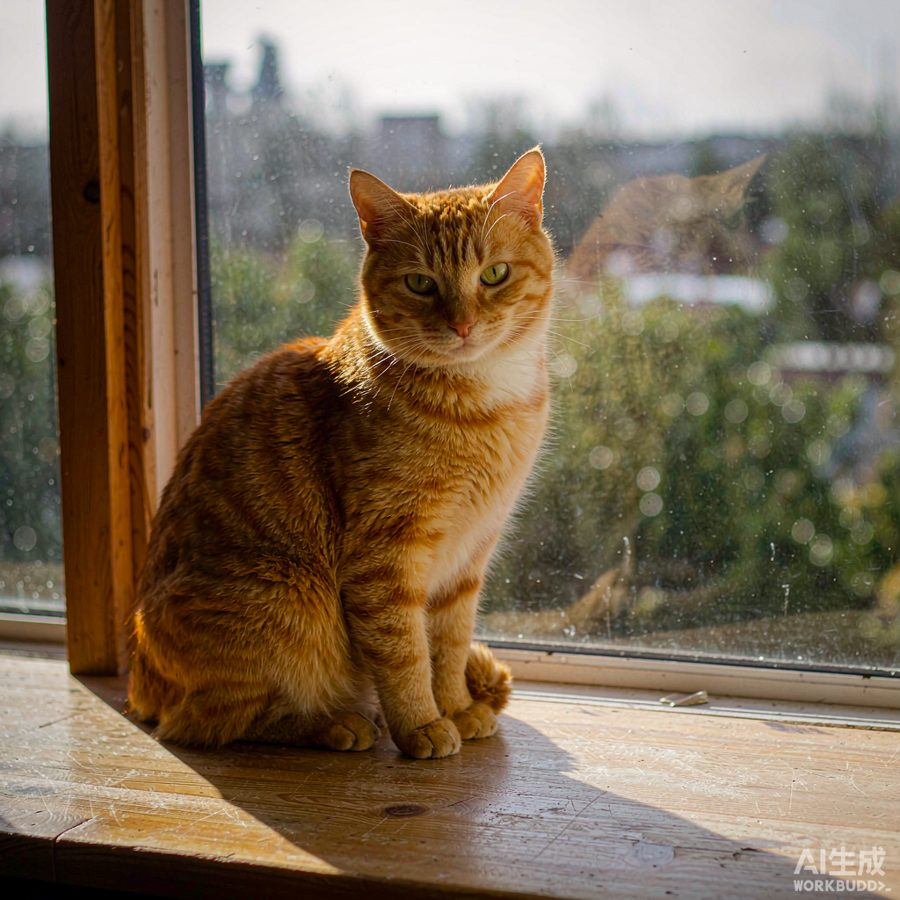

# Media Desk (WorkBuddy image generation)

**English** · [中文](README.md)

> Wires the Media Desk "DSH generation tool" mode to WorkBuddy image generation: **no separate image API purchase — draw with the WorkBuddy credits you already have.**

Jot one idea and get a finished draft — voiceover script, title, video cover, illustrations, and a six-panel storyboard. Covers, illustrations, and storyboard frames are produced by WorkBuddy's image models, sharing the same credit pool as its other capabilities.

---

## What this is

This project is a derivative distribution of [dsh-media-desk](https://github.com/woniuniuniu/dsh-media-desk) (upstream author [woniuniuniu](https://github.com/woniuniuniu), MIT). It keeps every upstream feature and adds one **bridge plugin**:

- Upstream supports two image sources: `Image API` (bring your own OpenAI-compatible endpoint and key) and `DSH generation tool` (reuse an image tool already registered in the host).
- The latter originally only supported `image_generate` as registered by `dsh-plugin-subscriptions`. The bridge in this project registers a tool under the same name, forwards the call to `workbuddy_draw_image` from [dsh-connect-workbuddy](https://github.com/dingminhua/dsh-connect-workbuddy), downloads the image into the directory the desk accepts, and hands it back.

Net result: **once the WorkBuddy plugin is installed and its image switch is on, the desk's "DSH generation tool" mode works with no image API key at all.**

## Result

The image below was **really produced** through this bridge (prompt: an orange cat sitting on a wooden windowsill in warm afternoon light, realistic photo, 1024x1024), generated by a WorkBuddy image model and persisted for the desk:



## Requirements

All of these are required:

1. **DeepSeek Harness** `>=0.2.1-rc.5 <0.3.0` (verified on `0.2.2-rc.1`)
2. **[dsh-connect-workbuddy](https://github.com/dingminhua/dsh-connect-workbuddy) installed** — image generation **depends entirely on it**; without it the bridge reports "workbuddy_draw_image not found"
3. **"Allow the model to generate images autonomously" enabled for the relevant region** in the WorkBuddy plugin settings — when off, that tool is never registered and the model cannot see it

## Install

### Option 1: install from GitHub source (available now)

```sh
dsh plugin --profile web add github:ccjiao/dsh-media-desk-workbuddy
```

Replace `web` with the profile you actually use (commonly `web` or `desktop`).

### Option 2: install from npm (pending release)

```sh
dsh plugin --profile web add dsh-media-desk-workbuddy
```

The npm package is being prepared; until that command succeeds for you, use the source install above.

### Option 3: install from a local directory

```sh
git clone https://github.com/ccjiao/dsh-media-desk-workbuddy.git
dsh plugin --profile web add ./dsh-media-desk-workbuddy
```

After installing, **refresh the DSH page**. If the sidebar entry is still missing, restart DeepSeek Harness (installed plugin modules must be reloaded).

## Usage

1. Refresh the page and open **Media Desk** in the sidebar
2. Open Settings → **Image source** → select **"DSH generation tool"**
3. It should now report available (the "subscription image tool not found" message is gone)
4. Click **Save**, then **Try one image** to verify the path
5. Go back to the inspiration board and generate a draft as usual

## Billing (important)

**Image generation really does consume WorkBuddy credits. It is not free.**

| Region | Reference price | Note |
|---|---|---|
| CN | about 5.71 credits per image | The two regions have **separate** credit pools |
| Global | about 0.03 credits per image | Not a cross-region price difference for the same image |

- These are reference values at the time of writing. **Actual charges are determined by the `credit` returned by WorkBuddy and by your usage panel.**
- Credits are not RMB and there is no official exchange rate; this project provides no conversion.
- One draft generates 9 images by default; lower that number in settings first. **Turning it down before trying** is the most direct way to control cost.
- When both regions are enabled, CN (the more expensive one) is preferred. To pin the cheaper region, turn off "Allow the model to generate images autonomously" for the region you do not want, in the WorkBuddy plugin settings.

## Permissions and external services

Check these before installing or reviewing:

| Item | Detail |
|---|---|
| Network requests | Only two: (1) downloading the image WorkBuddy returns (a signed COS URL); (2) the text-model endpoint you configure yourself (the desk writes scripts with it). **No data is reported to this project's author** |
| File access | Images are written to `<DSH_HOME>/plugins/subscriptions/images/`; desk state and drafts live in `~/.dsh/media-desk/` and your configured export directory |
| Credentials | This project **contains and reads no keys**. Text models use your existing DSH configuration; images use the WorkBuddy plugin's own session |
| Registered tool | One tool named `image_generate` (the name the desk looks for), which forwards to the WorkBuddy plugin |
| New dependencies | None. The bridge uses only Node built-ins |
| DSH version | `>=0.2.1-rc.5 <0.3.0` (verified on `0.2.2-rc.1`) |
| Platforms | Follows DSH: macOS / Windows / Linux, desktop and web |

## Compliance and disclaimer

**Read this section in full before use.**

1. **Unofficial integration.** Neither this project nor `dsh-connect-workbuddy` is an official product of, or officially supported by, Tencent / WorkBuddy / CodeBuddy. There is **no affiliation, partnership, endorsement, or authorization** of any kind. All related trademarks and service names belong to their respective owners.
2. **It uses the client's own interfaces, not a public API.** `dsh-connect-workbuddy` reuses the local WorkBuddy client's session and interfaces. Such interfaces may change with upstream revisions and **may stop working at any time**; keeping up requires following upstream updates.
3. **Assess account risk yourself.** Using unofficial interfaces may violate terms of service and carries a risk of rate limiting, feature restriction, or account action. Whether to use it is your decision and your risk; this project's author accepts no liability.
4. **You pay the costs.** All credit consumption is charged to your own WorkBuddy account.
5. **You are responsible for generated content.** You are responsible for the images you generate and their subsequent use (publishing, commercial use, portrait rights, copyright, and so on). Follow the laws and platform rules that apply to you.
6. **No warranty.** This project is provided "as is" under the MIT license, without warranty of any kind, express or implied.

This project contains **no** keys, accounts, or login credentials, and sends no data to the author or any third-party server.

## License and attribution

Released under **MIT**.

- Upstream [dsh-media-desk](https://github.com/woniuniuniu/dsh-media-desk) © 2026 woniuniuniu, MIT — all of its source code and artwork are redistributed unmodified under MIT; the original `LICENSE` is at [LICENSE](LICENSE).
- New parts of this project (`bridge/` and the packaging configuration) © 2026 ccjiao, MIT.
- Image generation comes from [dsh-connect-workbuddy](https://github.com/dingminhua/dsh-connect-workbuddy). **This project does not bundle or modify it; install it yourself.**

If upstream publishes a new release and you want to follow it, you must merge the upstream changes into this repository manually. This repository does not promise to track upstream on any schedule.

## Differences from upstream

Every change is listed here:

| Path | Change |
|---|---|
| `bridge/` | Added. The WorkBuddy image bridge plugin |
| `cordis.patch.yml` | Adds the bridge row; the desk row points at this repository's package name |
| `package.json` | Renamed package; adds derivative and attribution metadata |
| `src/`, `dist/`, `assets/` | **Unmodified**, identical to upstream 2.6.2 |

No other upstream code is changed.

## Troubleshooting

| Symptom | Fix |
|---|---|
| Settings still says "subscription image tool not found" | Confirm `dsh-connect-workbuddy` is installed and its image switch is on; refresh the page |
| Reports "workbuddy_draw_image not found" | The WorkBuddy plugin's image switch is off, or that plugin is not enabled |
| Image generation reports `NOT_LOGGED_IN` | That region is not signed in, or its image switch is off (this error costs no credits) |
| No sidebar entry | Refresh first; if still missing, restart DSH |
